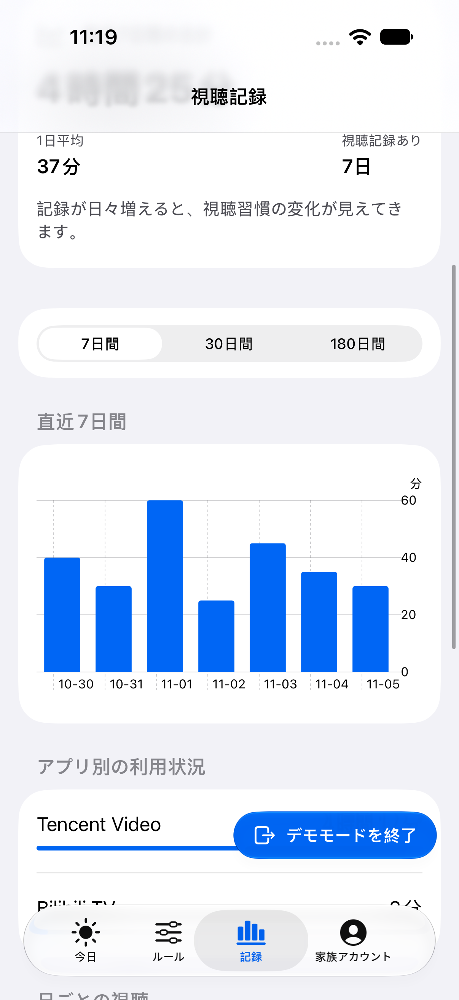
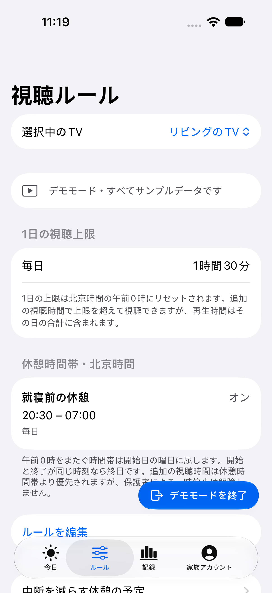
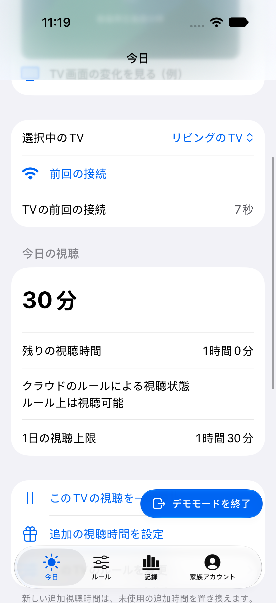
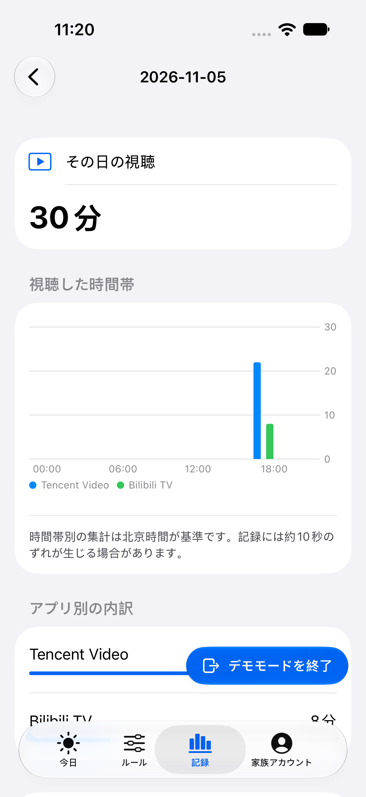
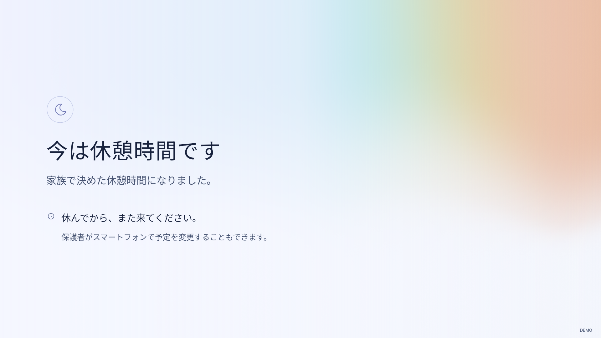

# Watchpace · 观有度

**テレビの時間を、家族の約束に。**

[English](README.md) · [简体中文](README.zh-CN.md) · [日本語](README.ja.md) · [한국어](README.ko.md)

Watchpace は、iPhone から家庭の Android TV の視聴時間を管理するアプリです。見る時間や休憩を決め、日々の視聴の変化を確認できます。

## できること

- **毎日のルールを決める。** 1日の視聴時間と、テレビを休ませる時間帯を設定できます。
- **その日に合わせて調整する。** iPhone から視聴を一時停止したり、時間を追加したりできます。
- **変化を振り返る。** 7日・30日・180日の推移、前の期間との比較、アプリ別の利用時間を確認できます。
- **1日を詳しく見る。** 日付を開くと、アプリ別の視聴時間と時間帯ごとの分布を確認できます。
- **家族で見守る。** 所有者の承認を得て、特定のテレビを共同管理できます。1台につき所有者を含む最大3つの保護者アカウントに対応します。
- **データの保存先を選ぶ。** 公式サービスでも、自分で用意したサーバーでも、同じアプリを使えます。

iPhone とテレビの画面は、英語・簡体字中国語・日本語・韓国語に対応しています。

## 画面を見る

スクリーンショットはデモデータを使用しています。テレビの画像は、Android クライアントをエミュレーターで実行した画面です。

| 視聴履歴 | 視聴ルール |
| --- | --- |
|  |  |

| 今日の視聴 | 1日の詳細 |
| --- | --- |
|  |  |

**テレビの休憩画面**



## はじめ方

iOS 17以降の iPhone、Android 8以降の対応テレビ、初回設定用のパソコンを用意してください。テレビへのインストール方法や権限設定はメーカーにより異なります。iPhone アプリはまだ App Store で公開されていないため、[開発ガイド](docs/development.md)（中国語）に従ってソースからビルドする必要があります。

1. Watchpace を開き、公式サービスまたは自分のサーバーを選び、家族アカウントを作成します。
2. テレビの追加から新規設定を選び、表示されたインストールページを、パソコン上の DSH、WorkBuddy、Cursor など信頼できる AI アシスタントに渡します。
3. テレビとパソコンを同じネットワークにつなぎ、案内に従って必要な権限を許可します。
4. アプリで再生制御と再起動の確認を終えてから、視聴ルールを設定します。

インストールページと一緒に、次の依頼文をアシスタントへ送れます。

> このインストールページを使って、Android TV に Watchpace を設定してください。リポジトリのテレビ設定スキルに従い、ページに表示されたサービスアドレスを使用してください。一度に1つずつ操作を案内し、再生制御、ADB デバッグの終了、完全な再起動後の再接続を確認してください。

詳しい手順は[テレビ設定スキル](installer/family-tv-setup/SKILL.md)（中国語）にあります。途中で中断した場合は、家族のデバイス一覧から対象のテレビを開いて再開できます。すでに家族が設定したテレビには、追加画面で共有用 QR コードを読み取って参加できます。

## サービスとプライバシー

テレビ用クライアントは無料のオープンソースです。サーバーは自分で運用することもできます。公式クラウドでは、希望する家庭向けにサブスクリプションを提供しています。家族単位の契約で、その家族が所有するテレビを管理する保護者で共有されます。

視聴集計は180日間保存されます。公式サービスの無料アカウントは当日の記録を閲覧でき、サブスクリプションで過去のレポートを閲覧できます。自分で運用するサービスには履歴閲覧が含まれます。アカウントとデータは選択したサービスに保存されます。

記録するのはアプリ名とサンプリングによる視聴時間です。動画のタイトル、映像、音声は記録しません。所有または管理の許可を得た機器にのみインストールし、家族に視聴ルールを説明してください。[プライバシーポリシー](https://tv.chengkai.wang/privacy.html)と[休憩の計画](docs/responsible-use.md)（中国語）もご覧ください。

## 自分のサーバーで使う

**Node.js 24、SQLite、HTTPS 対応のドメイン**を用意し、リポジトリのルートから実行します。

```sh
cd server
npm ci --ignore-scripts
npm run build:node
cp deploy/self-hosted.env.example .env
# .env に HTTPS ドメインと書き込み可能なローカルパスを設定します。
node --env-file=.env node-runtime/init.mjs
node --env-file=.env dist/node-server.mjs
```

[デプロイガイド](docs/deployment.md)（中国語）に沿って HTTPS と常時稼働を設定してください。その後、iPhone アプリで自分のサーバーを使う設定を選び、サービスアドレスを入力します。

## 開発に参加する

ビルドとテストについては [CONTRIBUTING](CONTRIBUTING.md) と[開発ガイド](docs/development.md)（中国語）をご覧ください。質問や提案は [GitHub Issues](https://github.com/princewck/watchpace/issues) へお寄せください。

[MIT License](LICENSE) · [サードパーティーのライセンス](THIRD_PARTY_NOTICES.md)
