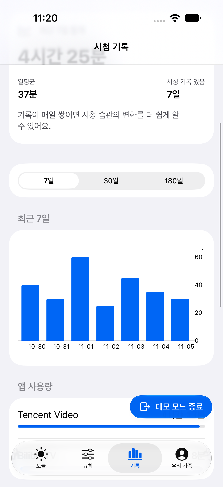
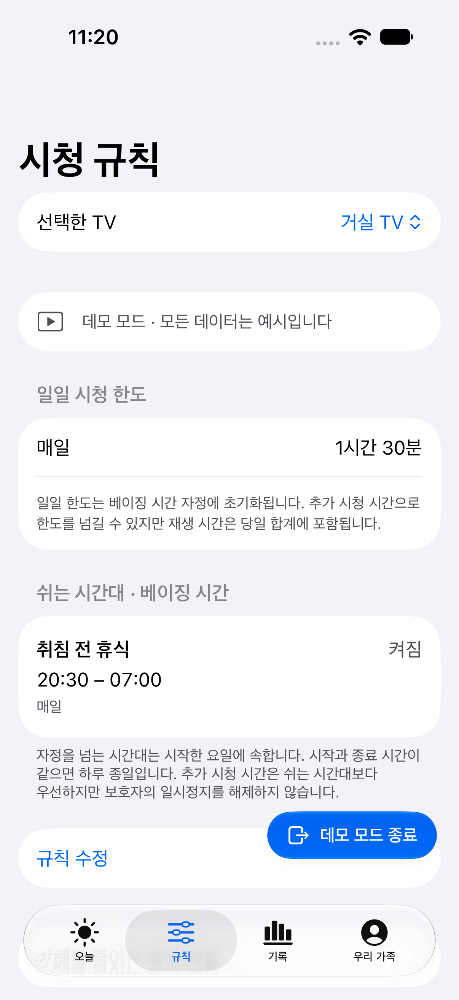
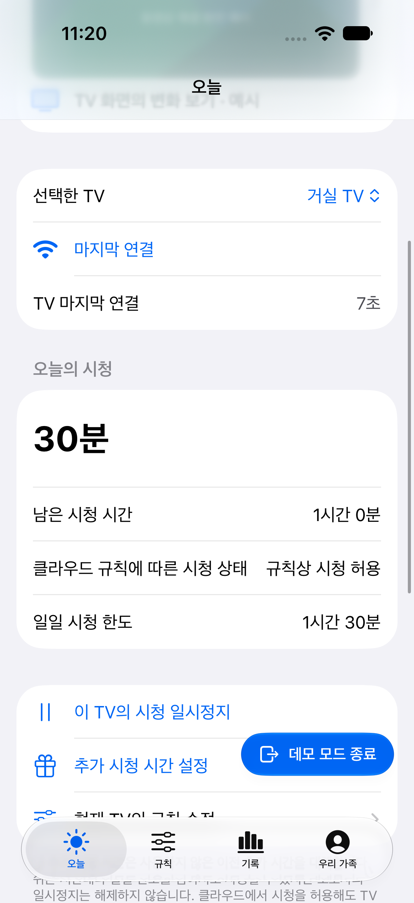
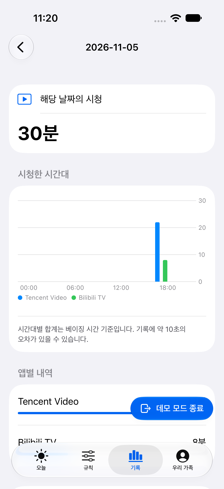
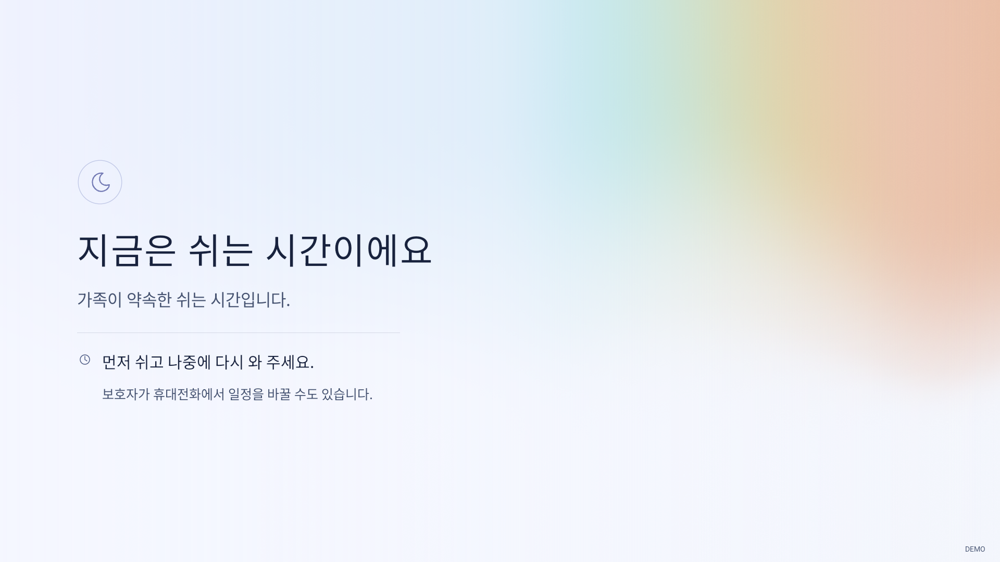

# Watchpace · 观有度

**TV 시청 시간을 가족의 약속으로.**

[English](README.md) · [简体中文](README.zh-CN.md) · [日本語](README.ja.md) · [한국어](README.ko.md)

Watchpace는 iPhone에서 집 안의 Android TV 시청 시간을 관리하는 앱입니다. 시청 시간과 휴식을 정하고, 매일의 시청 습관이 어떻게 달라지는지 살펴보세요.

## 주요 기능

- **일상에 맞는 규칙.** 하루 시청 한도와 TV를 쉬게 할 시간대를 설정할 수 있습니다.
- **필요할 때 유연하게.** 휴대폰에서 시청을 일시 중지하거나 시간을 추가할 수 있습니다.
- **변화를 한눈에.** 7일·30일·180일 추이, 이전 기간과의 비교, 앱별 사용량을 확인할 수 있습니다.
- **하루를 자세히.** 날짜를 선택하면 앱별 시청 시간과 시간대별 분포를 볼 수 있습니다.
- **함께 관리하기.** 소유자의 승인으로 특정 TV를 함께 관리할 수 있습니다. TV 한 대당 소유자를 포함해 보호자 계정 3개까지 지원합니다.
- **데이터 보관 장소 선택.** 공식 서비스나 직접 운영하는 서버를 같은 앱에서 이용할 수 있습니다.

iPhone과 TV 화면은 영어, 중국어 간체, 일본어, 한국어를 지원합니다.

## 화면 미리 보기

스크린샷에는 데모 데이터를 사용했습니다. TV 이미지는 Android 클라이언트를 에뮬레이터에서 실행한 화면입니다.

| 시청 기록 | 시청 규칙 |
| --- | --- |
|  |  |

| 오늘의 시청 | 하루 상세 기록 |
| --- | --- |
|  |  |

**TV 휴식 화면**



## 시작하기

iOS 17 이상 iPhone, Android 8 이상 호환 TV, 초기 설치에 사용할 컴퓨터가 필요합니다. TV 설치와 권한 설정 방법은 제조사에 따라 다릅니다. iPhone 앱은 아직 App Store에 출시되지 않았습니다. 설치하려면 [개발 안내](docs/development.md)(중국어)에 따라 소스에서 빌드해야 합니다.

1. Watchpace를 열고 공식 서비스 또는 직접 운영하는 서버를 선택한 뒤 가족 계정을 만드세요.
2. TV 추가에서 새 TV 설정을 선택하세요. 표시되는 설치 페이지를 컴퓨터의 DSH, WorkBuddy, Cursor 등 신뢰할 수 있는 AI 도우미에게 전달하세요.
3. TV와 컴퓨터를 같은 네트워크에 연결하고 안내에 따라 TV에서 필요한 권한을 허용하세요.
4. 앱에서 재생 제어와 재시작 확인을 마친 뒤 시청 규칙을 설정하세요.

설치 페이지와 함께 다음 요청을 도우미에게 보낼 수 있습니다.

> 이 설치 페이지를 사용해 Android TV에 Watchpace를 설정해 주세요. 저장소의 TV 설정 스킬을 따르고 페이지에 표시된 서비스 주소를 사용해 주세요. 한 번에 한 가지 작업씩 안내하고, 재생 제어, ADB 디버깅 종료, 완전히 재시작한 뒤 재연결까지 확인해 주세요.

자세한 절차는 [TV 설정 스킬](installer/family-tv-setup/SKILL.md)(중국어)에 있습니다. 설치가 중단되면 가족 기기 목록에서 해당 TV를 열어 이어서 진행할 수 있습니다. 다른 보호자가 이미 설정한 TV는 추가 화면에서 공유 QR 코드를 스캔해 참여하세요.

## 서비스와 개인정보

TV 클라이언트는 무료 오픈소스이며, 서버를 직접 운영할 수도 있습니다. 공식 클라우드 서비스는 선택형 가족 구독을 제공합니다. 해당 가족이 소유한 TV를 함께 관리하는 보호자들은 같은 구독을 공유합니다.

시청 집계는 180일 동안 보관됩니다. 공식 서비스의 무료 계정은 오늘 기록을 볼 수 있고, 구독하면 과거 시청 보고서를 볼 수 있습니다. 직접 운영하는 서비스에는 기록 조회가 포함됩니다. 계정과 데이터는 선택한 서비스에 보관됩니다.

앱 이름과 샘플링한 시청 시간을 기록하며, 영상 제목·화면·소리는 기록하지 않습니다. 본인 소유이거나 관리 권한을 받은 기기에만 설치하고 가족에게 시청 규칙을 설명해 주세요. [개인정보 처리방침](https://tv.chengkai.wang/privacy.html)과 [휴식 계획 안내](docs/responsible-use.md)(중국어)도 참고하세요.

## 직접 서버 운영하기

**Node.js 24, SQLite, HTTPS를 지원하는 도메인**을 준비한 뒤 저장소 루트에서 실행하세요.

```sh
cd server
npm ci --ignore-scripts
npm run build:node
cp deploy/self-hosted.env.example .env
# .env에 HTTPS 도메인과 쓰기 가능한 로컬 경로를 설정하세요.
node --env-file=.env node-runtime/init.mjs
node --env-file=.env dist/node-server.mjs
```

[배포 안내](docs/deployment.md)(중국어)에 따라 HTTPS와 상시 실행을 설정하세요. 이후 iPhone 앱에서 자체 서버 옵션을 선택하고 서비스 주소를 입력하면 됩니다.

## 프로젝트 참여

빌드와 테스트 방법은 [CONTRIBUTING](CONTRIBUTING.md)과 [개발 안내](docs/development.md)(중국어)를 참고하세요. 질문과 제안은 [GitHub Issues](https://github.com/princewck/watchpace/issues)에 남겨 주세요.

[MIT License](LICENSE) · [타사 라이선스 안내](THIRD_PARTY_NOTICES.md)
