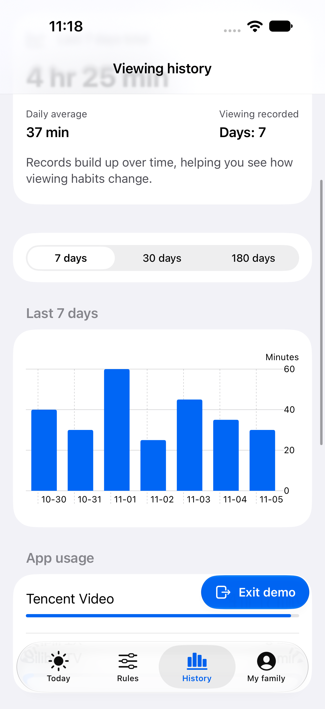
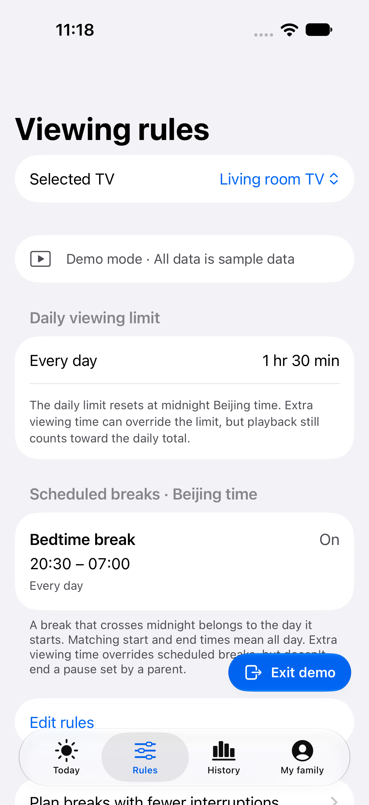
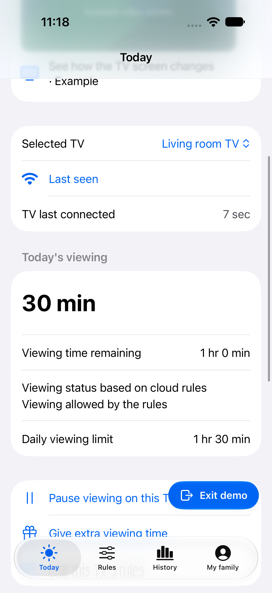
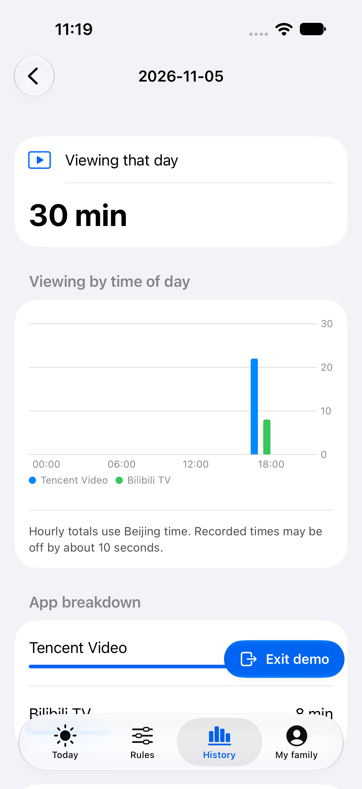
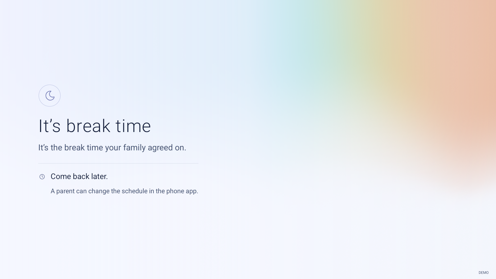

# Watchpace

**Make TV time a family agreement.**

[English](README.md) · [简体中文](README.zh-CN.md) · [日本語](README.ja.md) · [한국어](README.ko.md)

Watchpace helps parents manage an Android TV from their iPhone. Set viewing limits, plan breaks, and understand how TV time changes over time.

## What you can do

- **Agree on a routine.** Set daily allowances and times when the TV should take a break.
- **Stay flexible.** Pause viewing or give extra time from your phone.
- **See the bigger picture.** Explore 7-, 30-, and 180-day trends, compare with the previous period, and see which apps are used.
- **Look closer at a day.** View each app’s recorded time and an hourly breakdown.
- **Share the responsibility.** Invite another parent to manage a specific TV, with the owner’s approval. Each TV supports up to three parent accounts, including its owner.
- **Choose where your data lives.** Use the official service or connect the same app to your own server.

The iPhone app and TV interface support English, Simplified Chinese, Japanese, and Korean.

## Take a look

These screenshots use demo data. The TV images show the Android client running in an emulator.

| Viewing history | Viewing rules |
| --- | --- |
|  |  |

| Today’s viewing | A closer look at a day |
| --- | --- |
|  |  |

**A break on the TV**



## Get started

You need an iPhone with iOS 17 or later, a compatible Android TV running Android 8 or later, and a computer for initial setup. TV installation and permissions depend on the manufacturer. The iPhone app is not yet on the App Store; installation requires building from source using the [build guide](docs/development.md) (Chinese).

1. Open Watchpace, choose the official service or your own server, and create a family account.
2. Choose **Add TV → Set up a new TV**. Give the installation page to a trusted AI assistant on your computer such as DSH, WorkBuddy, or Cursor.
3. Follow the guided setup. Keep the TV and computer on the same network, and approve the permissions shown on the TV.
4. Finish the playback and restart checks in the app, then set your viewing rules.

You can paste this request into your computer assistant along with the installation page:

> Help me set up Watchpace on my Android TV using this installation page. Follow the repository’s TV setup skill, use the service address shown on the page, and guide me through one action at a time. Verify playback control, close ADB debugging, and check that the client reconnects after a full restart.

The [TV setup skill](installer/family-tv-setup/SKILL.md) provides the installation instructions. To resume an interrupted setup, open the TV under **My family → Family devices**. To join a TV that another parent already manages, choose **Scan a sharing code** when adding a TV.

## Service and privacy

The TV client is free and open source. You can deploy the server yourself; the official cloud service offers an optional family subscription. A subscription is shared by the parents managing TVs owned by that family.

Viewing summaries are retained for 180 days. On the official service, free accounts can view today’s records; a subscription opens historical reports. Self-hosted services include historical reports. Accounts and data belong to the service you select.

Records contain app names and sampled viewing durations, not video titles, pictures, or audio. Install only on devices you own or are authorized to manage, and explain the viewing rules to your family. See [privacy](https://tv.chengkai.wang/privacy.html) and [planning breaks](docs/responsible-use.md) (Chinese).

## Host your own server

Use **Node.js 24, SQLite, and a domain with HTTPS**. From the repository root:

```sh
cd server
npm ci --ignore-scripts
npm run build:node
cp deploy/self-hosted.env.example .env
# Set your HTTPS domain and writable local paths in .env.
node --env-file=.env node-runtime/init.mjs
node --env-file=.env dist/node-server.mjs
```

Configure HTTPS and keep the service running using the [deployment guide](docs/deployment.md) (Chinese). In the iPhone app, choose **Self-hosted** and enter your server address.

## Contribute

See [CONTRIBUTING](CONTRIBUTING.md) and the [development guide](docs/development.md) (Chinese) for build and test instructions. Questions and suggestions are welcome in [GitHub Issues](https://github.com/princewck/watchpace/issues).

[MIT License](LICENSE) · [Third-party notices](THIRD_PARTY_NOTICES.md)
