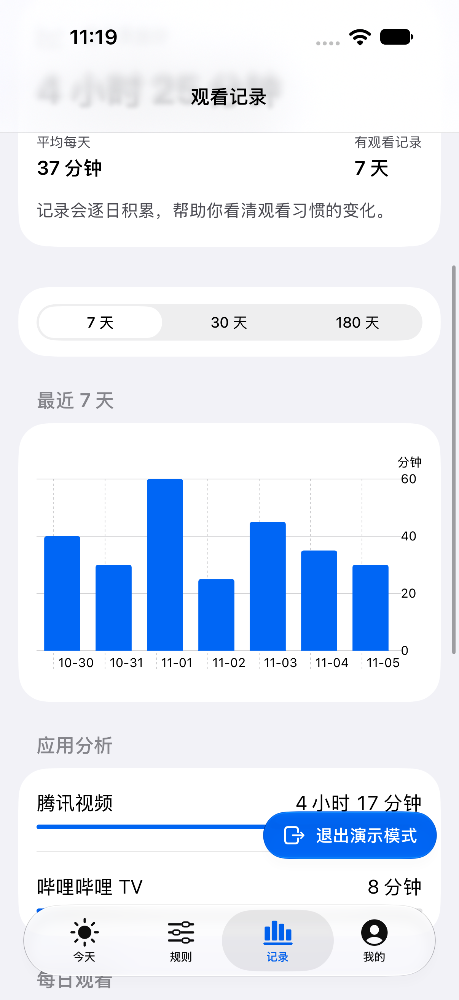
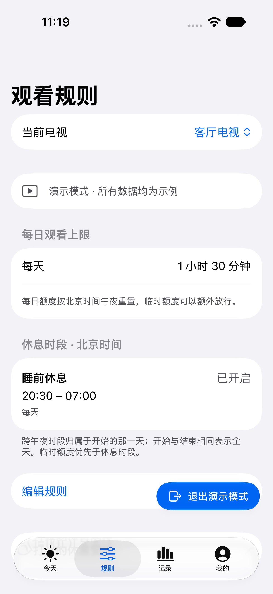
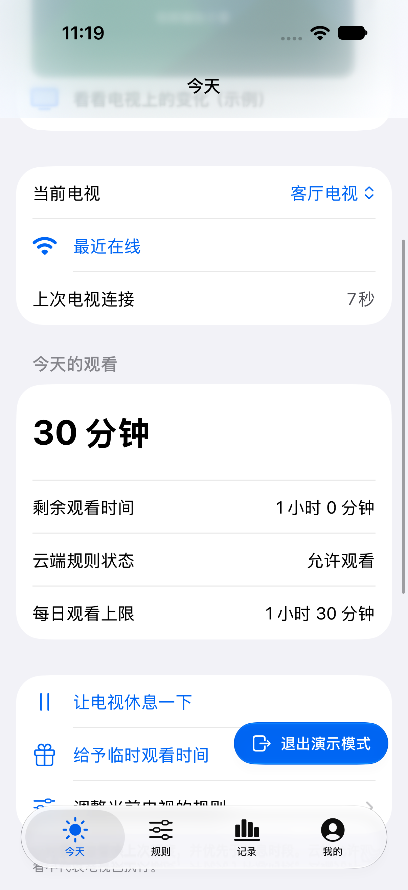
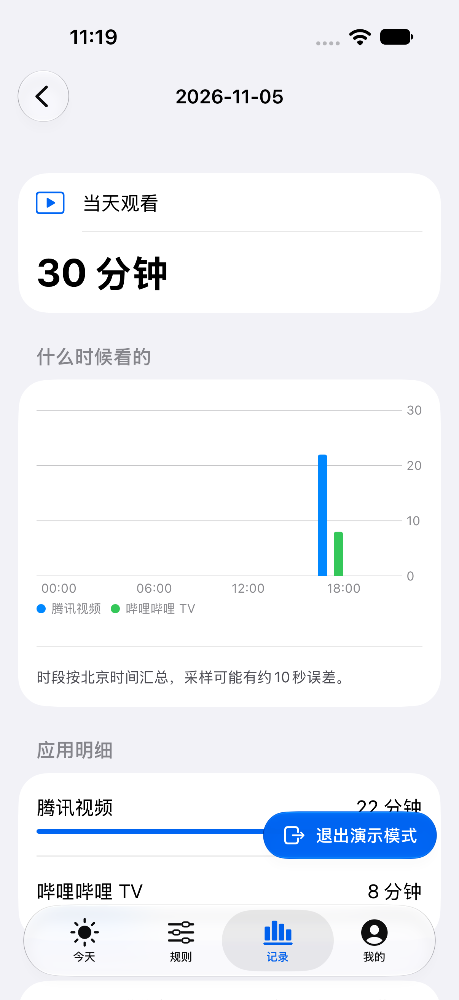

# Watchpace · 观有度

**让电视时间有约定。**

[English](README.md) · [简体中文](README.zh-CN.md) · [日本語](README.ja.md) · [한국어](README.ko.md)

用 iPhone 管理家里的 Android TV：约定观看时间、安排休息，也看清每天的观看习惯。

## 可以做什么

- **建立日常约定。** 设置每日观看额度，以及需要休息的时段。
- **灵活调整。** 在手机上暂停观看，或临时多给一点时间。
- **看清长期变化。** 查看 7、30、180 天趋势，与上一时段对比，并了解各应用用量。
- **了解每天怎么用。** 点开日期，查看应用时长和按小时汇总的观看分布。
- **一起照看。** 经电视拥有者同意后，共同管理指定电视。每台电视最多支持三个家长账号，包含拥有者。
- **自己选择数据存放处。** 使用官方服务，或让同一个 App 连接自己部署的服务器。

手机和电视界面均支持英语、简体中文、日语和韩语。

## 界面预览

截图使用演示数据；电视截图来自 Android 客户端在模拟器上的运行画面。

| 观看记录 | 观看规则 |
| --- | --- |
|  |  |

| 今天的观看 | 每日明细 |
| --- | --- |
|  |  |

**电视上的休息页面**


## 开始使用

准备一部 iOS 17 或更新版本的 iPhone、一台 Android 8 或更新版本的兼容电视，以及用于首次安装的电脑。不同品牌电视的安装与授权方式有所不同。iPhone App 尚未在 App Store 上架，安装需按[开发说明](docs/development.md)从源码构建。

1. 打开观有度，选择官方服务或自定义部署，创建家庭账号。
2. 选择“添加电视 → 安装新电视”，把安装页交给电脑上的 DSH、WorkBuddy、Cursor 等可信 AI 助手。
3. 按引导操作，让电脑和电视处于同一网络，并在电视上允许所需权限。
4. 在手机里完成播放和重启检查，再设置观看规则。

可以把下面这段话连同安装页一起发给电脑助手：

> 请根据这张安装页，帮我为 Android TV 安装观有度。遵循仓库的电视安装技能，使用页面显示的服务地址，一次引导我完成一个操作。请验证播放控制、关闭 ADB 调试，并确认完整重启后电视重新连接。

详细步骤见[电视安装技能](installer/family-tv-setup/SKILL.md)。安装中断后，到“我的 → 家庭设备”打开对应电视继续。如果另一位家长已经安装好电视，可在添加电视时选择“扫描分享码”加入。

## 服务与隐私

电视端开源免费，服务端支持自行部署。官方云服务提供可选的家庭订阅，由共同管理该家庭所属电视的家长共享。

观看汇总保留 180 天。官方服务的免费账号可查看当天记录，订阅后可查看历史报告；自部署服务包含历史报告。账号和数据保存在你选择的服务中。

记录包含应用名称和采样观看时长，不包含视频标题、画面或声音。请只在自有或已获授权的设备上安装，并向家人说明观看规则。更多说明见[隐私政策](https://tv.chengkai.wang/privacy.html)与[休息安排建议](docs/responsible-use.md)。

## 自行部署

准备 **Node.js 24、SQLite 和可通过 HTTPS 访问的域名**。从仓库根目录执行：

```sh
cd server
npm ci --ignore-scripts
npm run build:node
cp deploy/self-hosted.env.example .env
# 在 .env 中填写自己的 HTTPS 域名和可写的本地路径。
node --env-file=.env node-runtime/init.mjs
node --env-file=.env dist/node-server.mjs
```

按[部署说明](docs/deployment.md)配置 HTTPS 和常驻运行。随后在手机 App 中选择“自定义部署”，填写自己的服务地址。

## 参与项目

构建、测试和贡献方式见 [CONTRIBUTING](CONTRIBUTING.md) 与[开发说明](docs/development.md)。欢迎在 [GitHub Issues](https://github.com/princewck/watchpace/issues) 交流、反馈问题或提出建议。

[MIT License](LICENSE) · [第三方许可](THIRD_PARTY_NOTICES.md)
